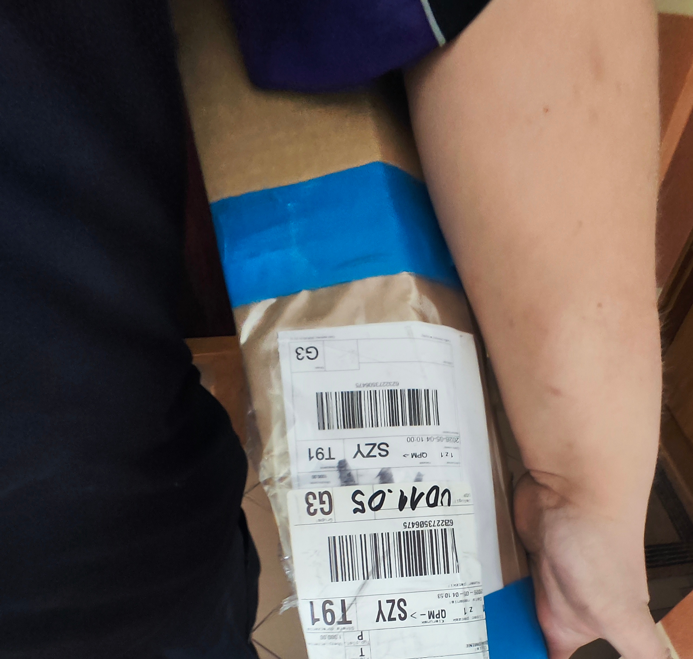
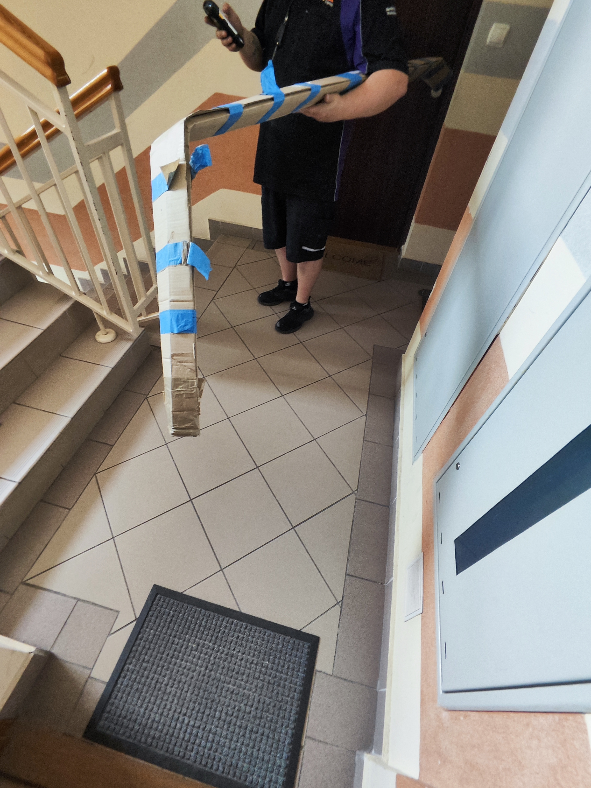

# Opinie o Meblowanko Sp. z o.o. (Chrząstowice)

Sprawdź opinie o meblowanko Sp. z o.o. Chrząstowice. Zobacz rzeczywiste zdjęcia, informacje o jakości wykonania, reklamacjach, terminach dostaw oraz podejściu firmy do obsługi i montażu.

# [http://www.meblowanko-opinie.pl/](http://www.meblowanko-opinie.pl/)

Realizacja:

| Adres                            |                | MEBLOWANKO SP. Z O.O.<br>ul. Śluzowa 4<br>46-053 Chrząstowice<br>NIP: 9910564230<br>KRS: 0001211180<br>REGON: 543486025        |
| -------------------------------- | -------------- | ------------------------------------------------------------------------------------------------------------------------------ |
| meblowanko on Google Maps        |                | [meblowanko on Google Maps](https://www.google.com/maps/search/?api=1&query=Google&query_place_id=ChIJLdLLG_pVEEcR1ZhxcRKMtH4) |
| Strona www:                      |                | https://meblowanko.pl/                                                                                                         |
| Allegro:                         |                | [użytkownik meblowanko_pl](https://allegro.pl/uzytkownik/meblowanko_pl/oceny)                                                  |
|                                  | Nr telefonu:   | +48 608 887 694                                                                                                                |
|                                  | Adres e-mail:  | ltq1valnd9@allegromail.pl                                                                                                      |
| Fixly (aktywne od 2026.11):      | dateRegistered | 2026-11-17T06:51:30.000Z                                                                                                       |
|                                  | profil         | [https://fixly.pl/profil/6a9npa0e](https://fixly.pl/profil/6a9npa0e)                                                           |
|                                  | Nr telefonu:   | +48 888 992 340                                                                                                                |
|                                  | Adres e-mail:  | biuro@meblowanko.pl                                                                                                            |
|                                  |                | [https://fixly.pl/profil/6a9npa0e/dodaj-opinie](https://fixly.pl/profil/6a9npa0e/dodaj-opinie)                                 |
| Fixly (nieaktywne od 2026.11):   | dateRegistered | 2023-12-03T13:02:59.000Z                                                                                                       |
|                                  | profil         | https://fixly.pl/profil/so7qmueg                                                                                               |
|                                  | Nr telefonu:   | +48 885 574 340                                                                                                                |
|                                  | Adres e-mail:  | kontakt@meblowanko.pl                                                                                                          |
|                                  | profil         | https://fixly.pl/profil/meble-na-zamowienie                                                                                    |
|                                  | profil         | https://fixly.pl/profil/meblowanko                                                                                             |
|                                  | lastActivity   | 2026-11-16T20:42:06.000Z                                                                                                       |

# Spis treści
- [Ostatnie pobrane komentarze ze zdjęciami (stan na 20 listopada 2026)](#ostatnie-pobrane-komentarze-ze-zdjęciami-stan-na-20-listopada-2026)
- [Przedmiot zamówienia](#przedmiot-zamówienia)
- [Reklamacja A04032026 z dnia 16.04.2026](#reklamacja-a04032026-z-dnia-16042026)
- [Reklamacja A04032026 z dnia 06.05.2026](#reklamacja-a04032026-z-dnia-06052026r)
  - [Niektóre wskazane wady](#dodatkowo-stwierdzono-liczne-wady-wykonania-oraz-uszkodzenia-po-pierwszym-dniu-montarzu)
- [Jakość pakowanie przesyłek](#jako%C5%9B%C4%87-pakowania-przesy%C5%82ek)
- [Prokuratura](#prokuratura)
- [KRS](#krs-itp)




# Przedmiot zamówienia
```
MEBLOWANKO – Warunki Realizacji Zamówienia
1. Przedmiot zamówienia
Przedmiotem zamówienia jest wykonanie, dostawa oraz montaż mebli realizowanych na
indywidualne zamówienie Zamawiającego, zgodnie ze specyfikacją zamówienia.
```
Całość - [MEBLOWANKO – Warunki Realizacji Zamówienia.pdf](./pdf/MEBLOWANKO – Warunki Realizacji Zamówienia.pdf)

[Zdjęcia](https://github.com/pandlab/meblowanko-opinie/tree/main/photo)



# Jakość pakowania przesyłek:

"przesyłka zawierająca cokolik U6933VL o wymiarach 2136 × 97 × 18 mm została nadana"





# Prokuratura

Osoby, które uważają, że mogą być pokrzywdzone w podobnej sprawie lub posiadają istotne informacje, mogą powołać się na postępowanie prowadzone przez Prokuraturę Rejonową Toruń Centrum–Zachód sygn. akt: 4074 – 4.Ds.2179.2026


