# Ostatnie pobrane komentarze ze zdjęciami (stan na 20 listopada 2026)

➡️ [https://www.meblowanko-opinie.pl/fixly/ostatnie-komentarze-fixly-so7qmueg.html](https://www.meblowanko-opinie.pl/fixly/ostatnie-komentarze-fixly-so7qmueg.html)

> kontakt@fixly.pl : Jeżeli dany profil nie istnieje, a konwersacja z nim nie jest już widoczna, może oznaczać to tylko jedną sytuację - wykonawca usunął swoje konto i wszystkie dane z nim związane z serwisu Fixly.

Dane surowe: [https://www.meblowanko-opinie.pl/fixly/provider_so7qmueg.json](https://www.meblowanko-opinie.pl/fixly/provider_so7qmueg.json) [and more](https://www.meblowanko-opinie.pl/fixly/provider_more_so7qmueg.json)

```
      "yearEstablished": 2020,
      "yearsOfExperience": 6,
      "dateRegistered": "2023-12-03T13:02:59.000Z",
      "lastActivity": "2026-11-16T20:42:06.000Z",
```

```
      "company": {
        "id": "83108",
        "nip": "9910564230",
        "name": "MEBLOWANKO SPÓŁKA Z OGRANICZONĄ ODPOWIEDZIALNOŚCIĄ",
        "contactName": null,
        "address": "ul. Śluzowa 4, 46-053 Chrząstowice",
        "foundationDate": "2025-12-11T00:00:00.000Z",
        "verificationStatus": "VERIFIED"
      },
```

```
        {
          "id": "VerifiedCompany",
          "title": "Dane firmy sprawdzone w GUS",
          "tooltip": null
        },
```

## Opinia ID: `1588150` (2026-08-12 13:05:18 UTC) — Paweł, Toruń (ocena: 1/5)

> Monter po prostu wyszedł w trakcie montażu twierdząc, że nie potrafi prosto. Nie sporządzono żadnego protokołu odbioru mebli, mimo wpłaconej 100% zaliczki. Spółka poinformowała później, że "Zamówienie zostało wykonane w zakresie dostawy i montażu, a meble zostały wydane i zamontowane w miejscu wskazanym przez klienta w dniu 16.04.2026 r. Od tego momentu przedmiot zamówienia pozostaje w użytkowaniu.". Tymczasem meble pozostały w stanie jak na zdjęciach, a do tego wióry, tłuste plamy, uszkodzona ściana, niezlicowane korpusy i niewyregulowane fronty. Polecam sprawdzić inne opinie o panu Tomaszu.

**Odpowiedź spółki** (ID: `67394`, 2026-08-14 16:56:46 UTC):
> Przedstawiona opinia pomija istotne fakty. Przez kolejne miesiące, wielokrotnie, kontaktowaliśmy się z klientem, deklarując gotowość do wykonania serwisu i prosząc o wskazanie dogodnego terminu wizyty. Zamiast uzgodnić termin i doprowadzić sprawę do rozwiązania, klient konsekwentnie ją eskalował, kierując ją do kolejnych instytucji. Pełna korespondencja potwierdza nasze wielokrotne próby rozwiązania sprawy oraz gotowość do wykonania serwisu.

|  |  |
|--|--|
| 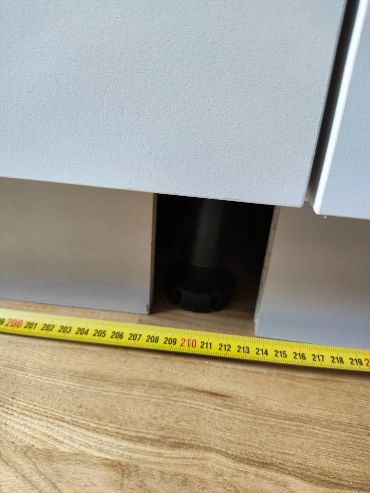<br>`https://cdn.fixly.pl/feedback/4181043-abf4fe007e088efdd971d799a6f36065.jpg` | 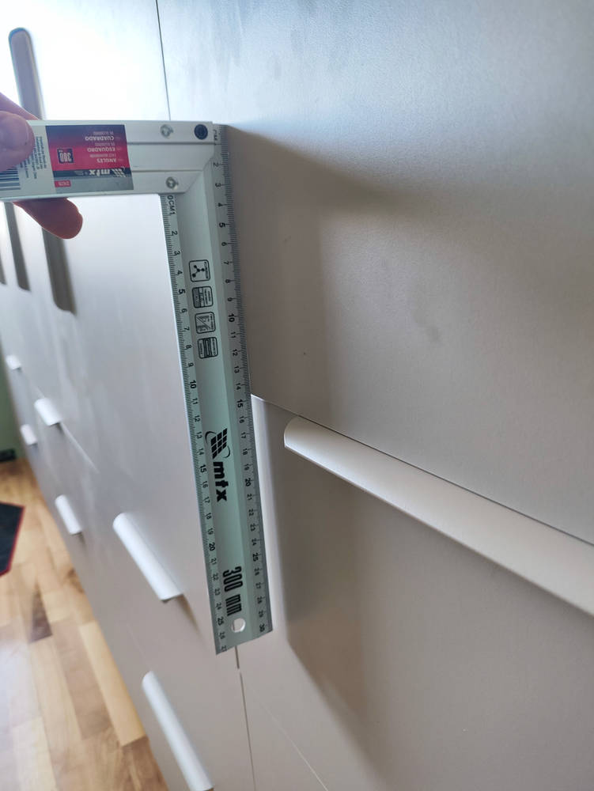<br>`https://cdn.fixly.pl/feedback/4181043-610ca4e34ea151314d65475ca8b62a75.jpg` |
| 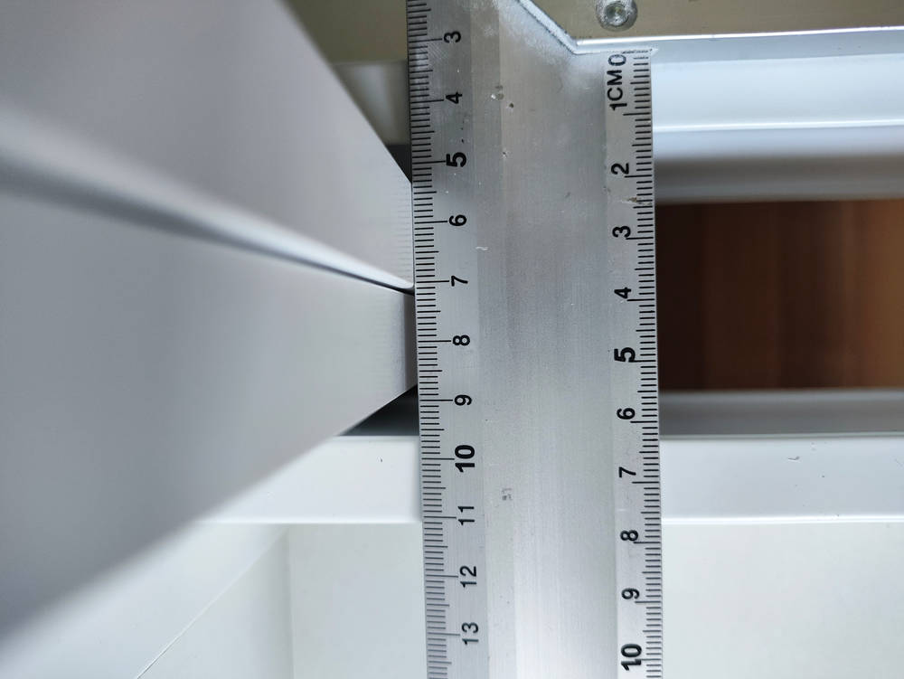<br>`https://cdn.fixly.pl/feedback/4181043-1a03dffc81b2c1794929d72010f3e12b.jpg` | 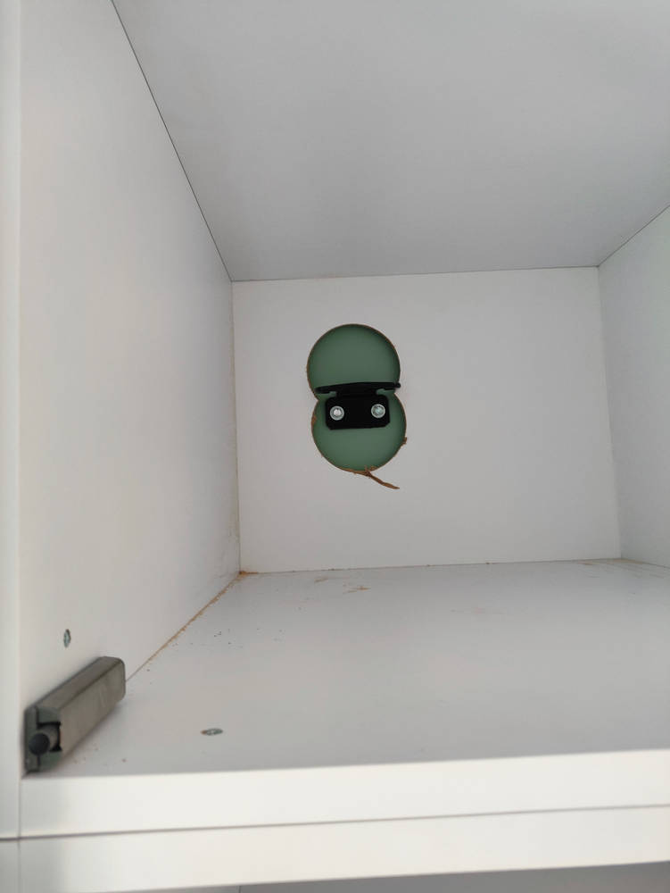<br>`https://cdn.fixly.pl/feedback/4181043-5473d41bf0efcc6c39da5e9399ad31ac.jpg` |
| 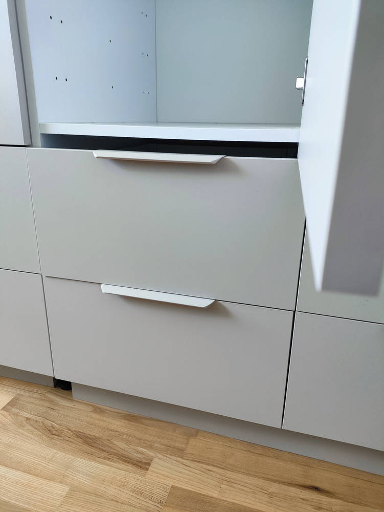<br>`https://cdn.fixly.pl/feedback/4181043-89061b4e788c216184e49addef7dac1e.jpg` |  |

---

## Opinia ID: `1575833` (2026-07-24 10:09:30 UTC) — Magda, Kielce (ocena: 1/5)

> Oczekuję dokończenia montażu, dowiezienia brakujących elementów oraz regulacji mebli przez firmę Meblowanko. W zależności od rozwoju zdarzeń opiszę sytuację dokładniej.

**Odpowiedź spółki** (ID: `67395`, 2026-08-14 16:58:25 UTC):
> Zamówienie zostało zrealizowane zgodnie ze specyfikacją zamówienia. Klient został poinformowany o możliwości dokupienia dodatkowych elementów za symboliczną opłatą. Co najmniej jedno zdjęcie, które zostało zamieszczone zostało wykonane przed zakończeniem prac.

|  |  |
|--|--|
| 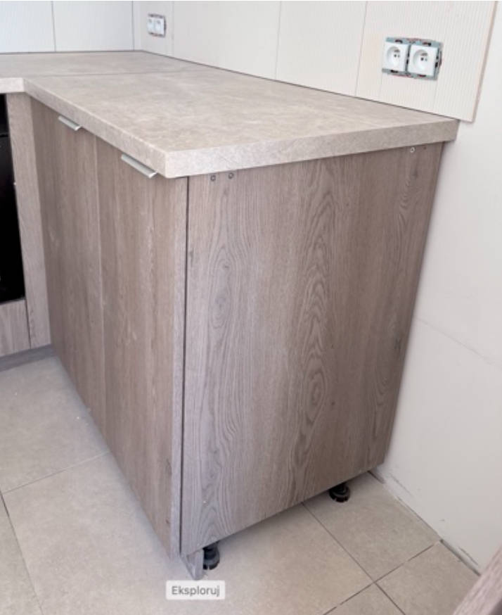<br>`https://cdn.fixly.pl/feedback/974572-05989594e5416536f257da6cb00cf234.jpg` | 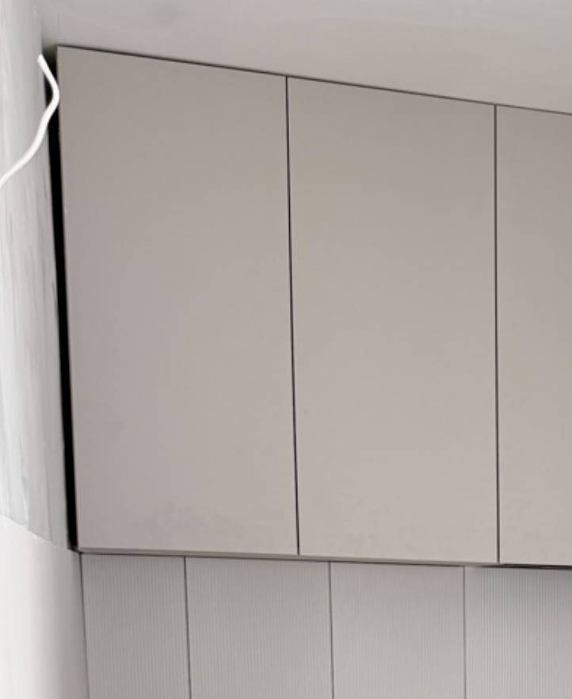<br>`https://cdn.fixly.pl/feedback/974572-e73a9fbfd7d1dea76be559c2c0f0daac.jpg` |
| 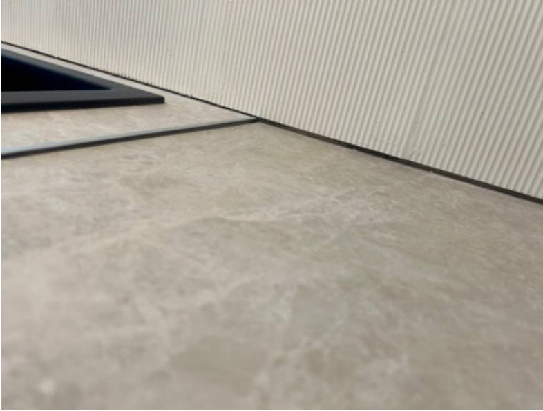<br>`https://cdn.fixly.pl/feedback/974572-1304087dd74c5d837a25ffc0086155ab.jpg` | 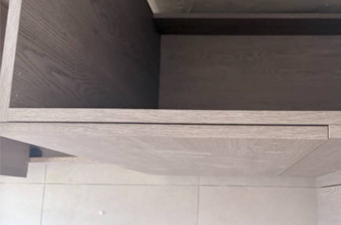<br>`https://cdn.fixly.pl/feedback/974572-b69376dae1c899d5bf14a99646ee2c90.jpg` |

---

## Opinia ID: `1537566` (2026-05-24 13:32:19 UTC) — Agnieszka, Kudowa-Zdrój (ocena: 5/5)

> Zlecenie zostało wykonane szybko i profesjonalnie. Bardzo dobry kontakt oraz wysoka jakość usługi. Polecam!

*Brak odpowiedzi spółki.*

|  |
|--|
| 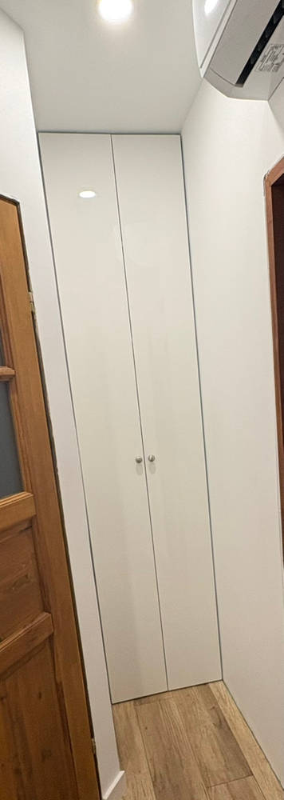<br>`https://cdn.fixly.pl/feedback/4061190-9825c61d4309f6a3b3111b60d9d0b4ee.jpg` |

---

## Opinia ID: `1521987` (2026-04-29 11:24:35 UTC) — Dawid, Śliwniki (ocena: 2/5)

> Termin realizacji szybki. Lecz jakość wykonania nie do końca spełnia moje oczekiwania, za kwotę którą otrzymałem przy wycenie spodziewałem się czegoś lepszego i dokładniejszego wykonania. Klamka ze zdjęć nie była wliczona w projekt.

**Odpowiedź spółki** (ID: `64243`, 2026-04-30 06:27:37 UTC):
> Opinia zasadniczo się zgadza, poza gwiazdkami :) Zrobiliśmy te piękne drzwi w zaledwie trzy dni i zrobiliśmy również montaż w rewelacyjnym czasie. Na pierwszym zdjęciu widzimy idealne spasowanie na zawiasach, dodatkowo zamontowaliśmy zawiasy, które wytrzymają wiele lat, moim zdaniem bardzo dobre wykonanie w jeszcze lepszym czasie :)

|  |  |
|--|--|
| 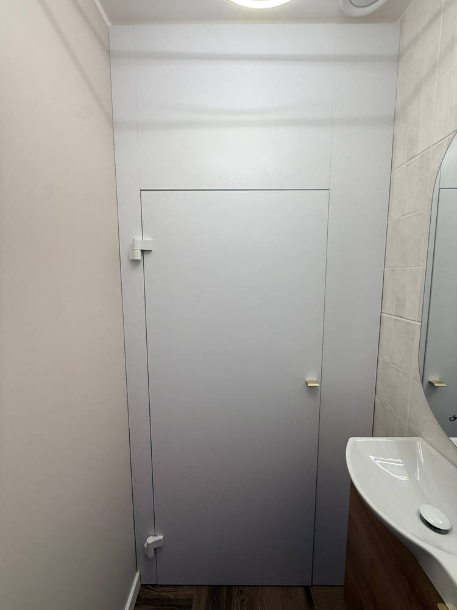<br>`https://cdn.fixly.pl/feedback/3967379-58522221d4514c2bde0536d04d8c2eaf.jpg` | 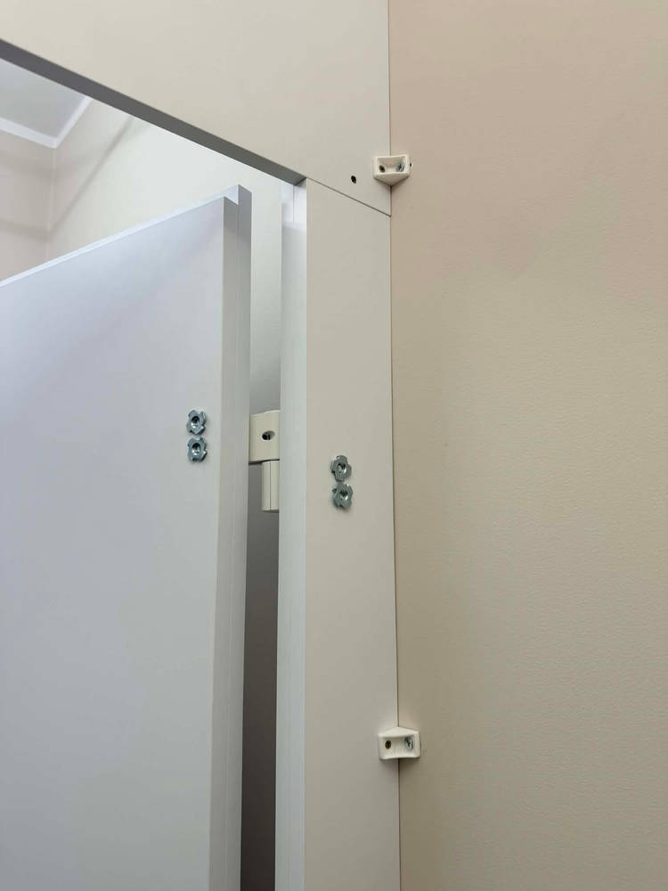<br>`https://cdn.fixly.pl/feedback/3967379-b6c2a5f45a76c437f5d4c50835e45cdc.jpg` |
| 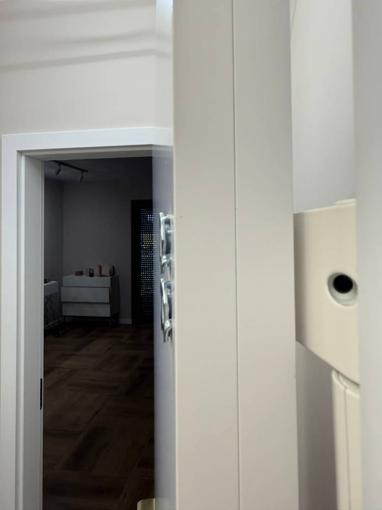<br>`https://cdn.fixly.pl/feedback/3967379-050d9c0be738d994fee86f0b006cbe0e.jpg` | 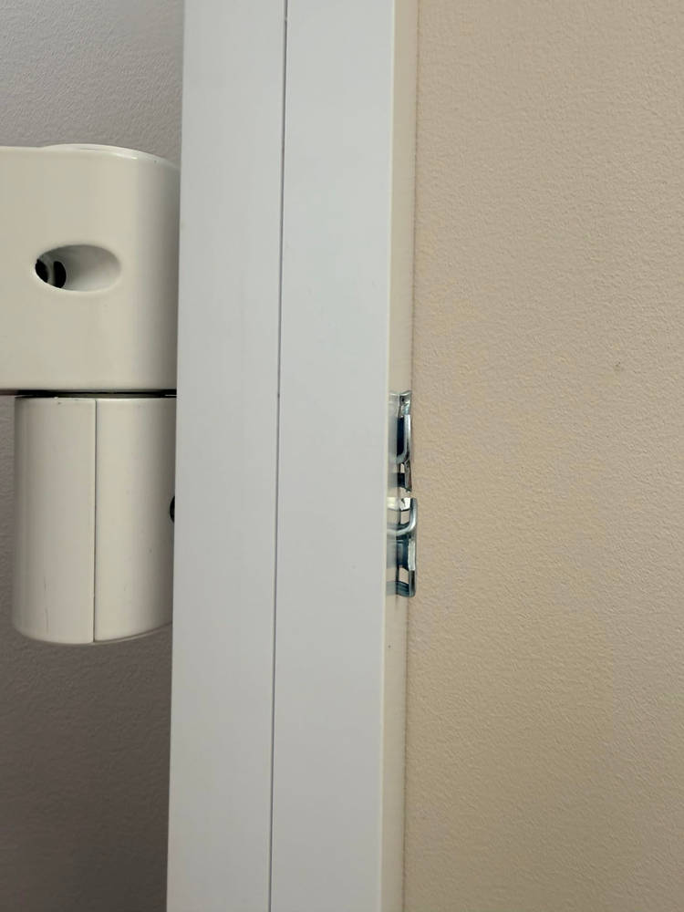<br>`https://cdn.fixly.pl/feedback/3967379-1b53c6bf30ab46cc80a59811da154a35.jpg` |
| 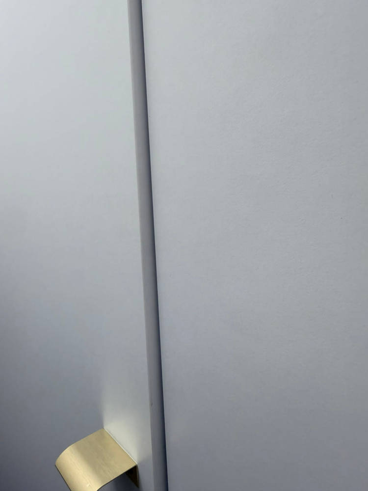<br>`https://cdn.fixly.pl/feedback/3967379-134dfff08f1a0002d95f6ecb472fd30e.jpg` |  |

---

## Opinia ID: `1415764` (2025-11-11 12:03:14 UTC) — Krzysztof, Opole (ocena: 1/5)

> NIEPOLECAM zdjecia mowia same za siebie szkoda ze jest limit. Umawianie sie to jakas tragedia ciagle nie odbieranie telefonu. Nie przyjezdzanie na umowiony termin. Meble brudne, od kleju, wiorow bo cieciu. Ciecie u klienta bez odkurzacza uszkodzenie sciany na klatce schodowej. Doprowadzenie mebli po tej wizycie to kilka godzin odkurzania i mycia. Uszkodzenie scian, w innym pokoju przewiercenie na wylot sciany. Nie rowne łaczenia. Brak wlacznika do swiatel brak zaslepek kolki odstaja na scisny. Ogolnie tragedia…

**Odpowiedź spółki** (ID: `57958`, 2025-11-11 12:27:05 UTC):
> Pana ocena ma bardzo luźny związek z rzeczywistością wobec czego zostanie zgłoszona jako pomówienie. Faktycznie, czasem jest ciężko odebrać telefon, natomiast zawsze oddzwaniamy, a co do terminu to Pan go przekładał, z uwagi na profesjonalizm, nie będziemy przytaczać szczegółów. Co do ścian, informowaliśmy że jeśli ściana ma grubość taką a nie inną to tak się wydarzy, nie jesteśmy winni, że obecnie mieszkania budowane są ze ścian 8cm. Wobec wszystkiego należy wspomnieć, że z uwagi na dobro relacji również udzieliliśmy Panu rabatu. Dodam, że nie wnosiliśmy mebli klatką schodową, a widną.

|  |  |
|--|--|
| 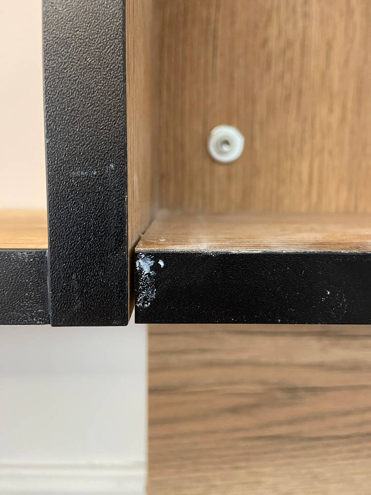<br>`https://cdn.fixly.pl/feedback/1088473-e04fac5e1dea183b52ea247d5b73add8.jpg` | 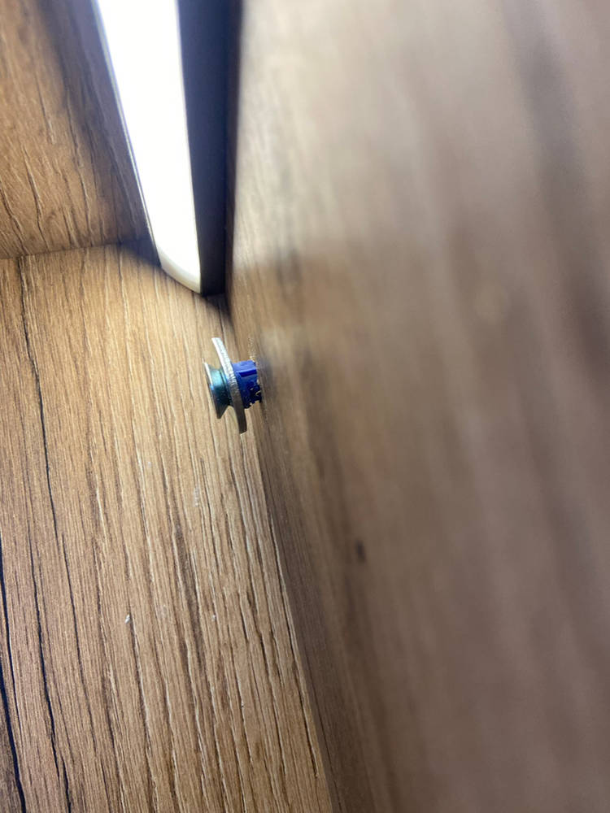<br>`https://cdn.fixly.pl/feedback/1088473-cf56b887ae9c8f1e9c95e72823448c80.jpg` |
| 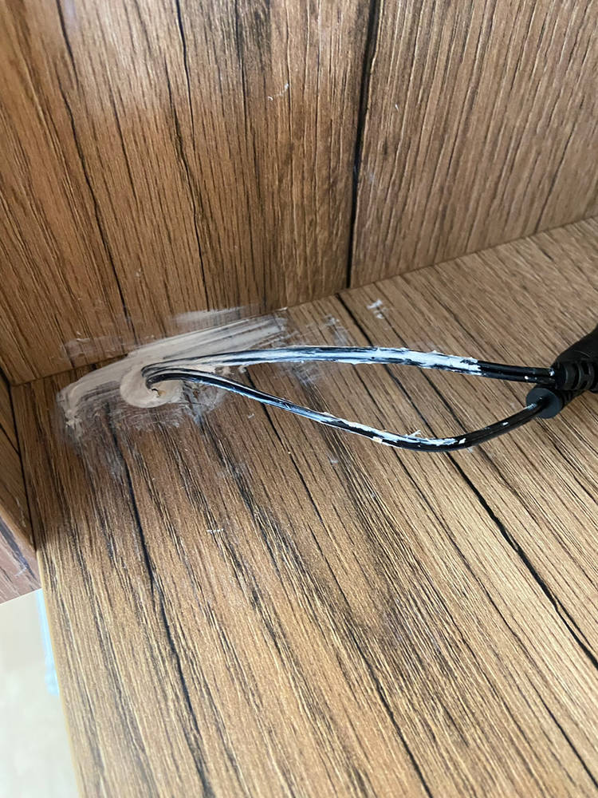<br>`https://cdn.fixly.pl/feedback/1088473-500199d667e5960b4aff2ea221dd02c3.jpg` | 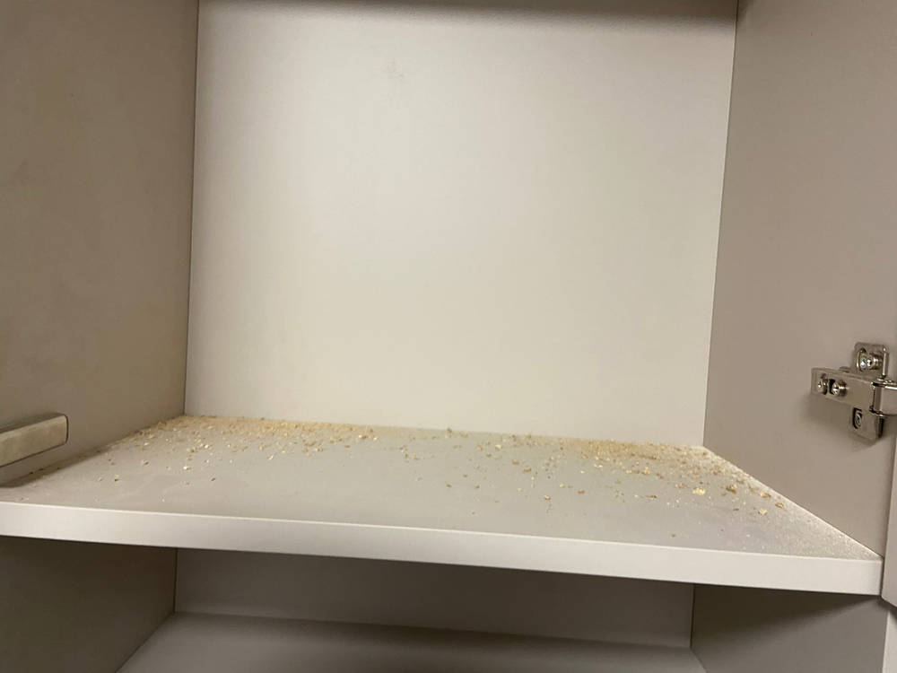<br>`https://cdn.fixly.pl/feedback/1088473-f2cac8b219a67e8ccef3b2f4895ebc88.jpg` |
| 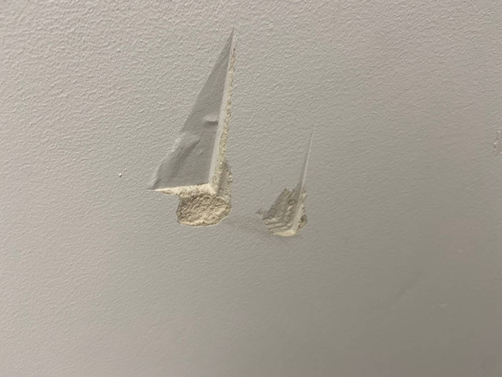<br>`https://cdn.fixly.pl/feedback/1088473-0126aedb298f7a14eebec45ddc7e9a97.jpg` |  |

---

## Opinia ID: `1315880` (2025-06-10 11:22:18 UTC) — Katarzyna, Kielce (ocena: 5/5)

> Proszę się nie sugerować pojedynczymi negatywnymi komentarzami u Pana Tomka... albo to konkurencja, albo wredni klienci, którzy zawsze muszą zaspokoić swoje ego i pomarudzić (a takich nie brakuje).
> Szafa w naszym przypadku wykonana wzorcowo, zgodnie z naszym dokładnym projektem, ze wskazaniem konkretnego materiału (odcień płyty konkretnego producenta). Od momentu zamówienia minęły trzy tygodnie i szafa stoi na miejscu! Wszystko idealnie spasowane, bez żadnych uszczerbków, a na jakiekolwiek sugestie w trakcie montażu Pan Tomek reaguje bezproblemowo. Cenowo również bardzo atrakcyjnie w porównaniu do innych ofert. Reasumując, wystarczy pozytywne nastawienie z obu stron, miły kontakt od początku i mamy finał w postaci super wykonanej pracy. Będę polecał!!!

*Brak odpowiedzi spółki.*

|  |
|--|
| 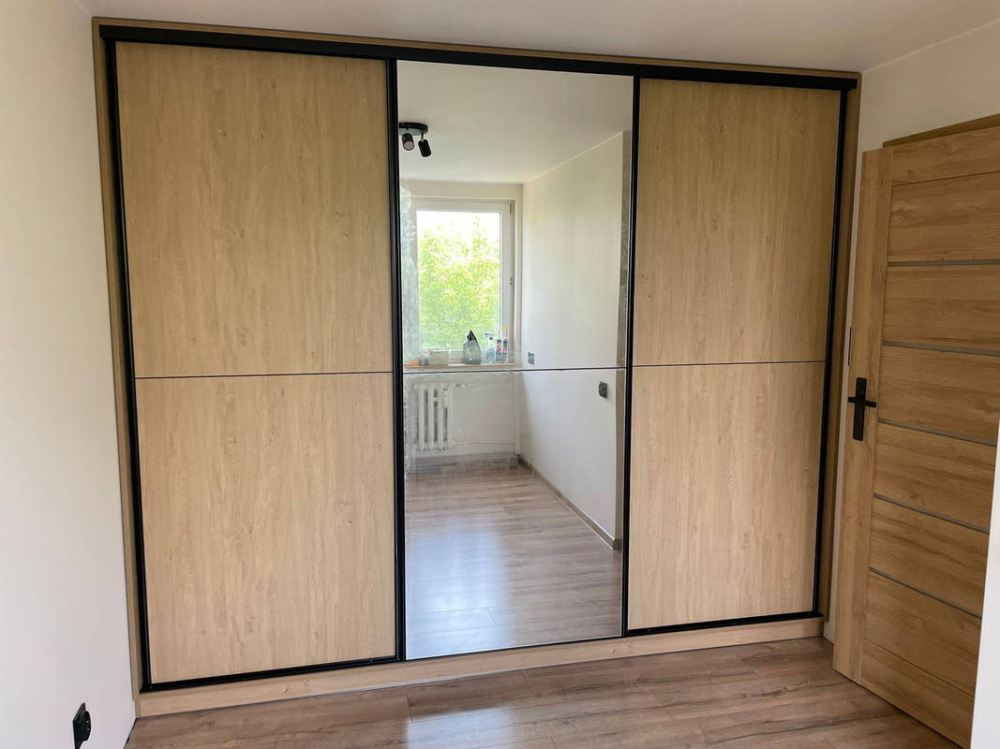<br>`https://cdn.fixly.pl/gallery/3627674-6ce2c152c519a5bca62fd7f7d17c3426.jpg` |

---

## Opinia ID: `1245560` (2025-02-08 19:45:12 UTC) — Marcin, Święta Katarzyna (ocena: 5/5)

> Polecam, jestem zadowolony z efektu końcowego. Wszystko zgodnie z ustaleniami, moim projektem. Kontakt bardzo dobry, cierpliwość jeśli chodzi o moje pomysły:) Kolory takie jak sobie wybrałem, montaż sprawny, zaangażowanie dlatego zachęcam do skorzystania z usług

**Odpowiedź spółki** (ID: `50823`, 2025-02-12 20:13:56 UTC):
> Ślicznie dziękuję za poświęcony czas na wystawienie opinii.
> To budujące, gdy klienci doceniają zaangażowanie, praca dla WAS to czysta przyjemność :)

|  |  |
|--|--|
| 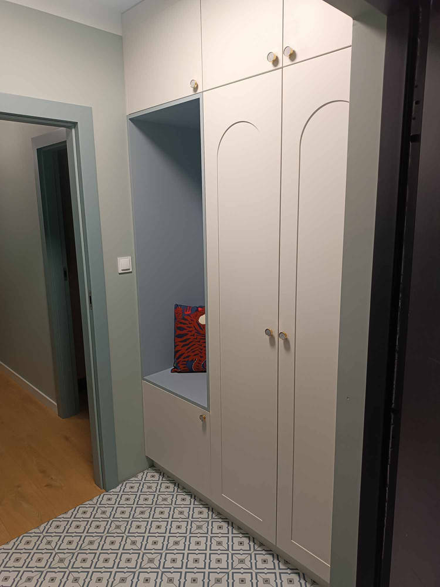<br>`https://cdn.fixly.pl/feedback/2268275-e1a111519ec3c967a279e77750b4a591.jpg` | 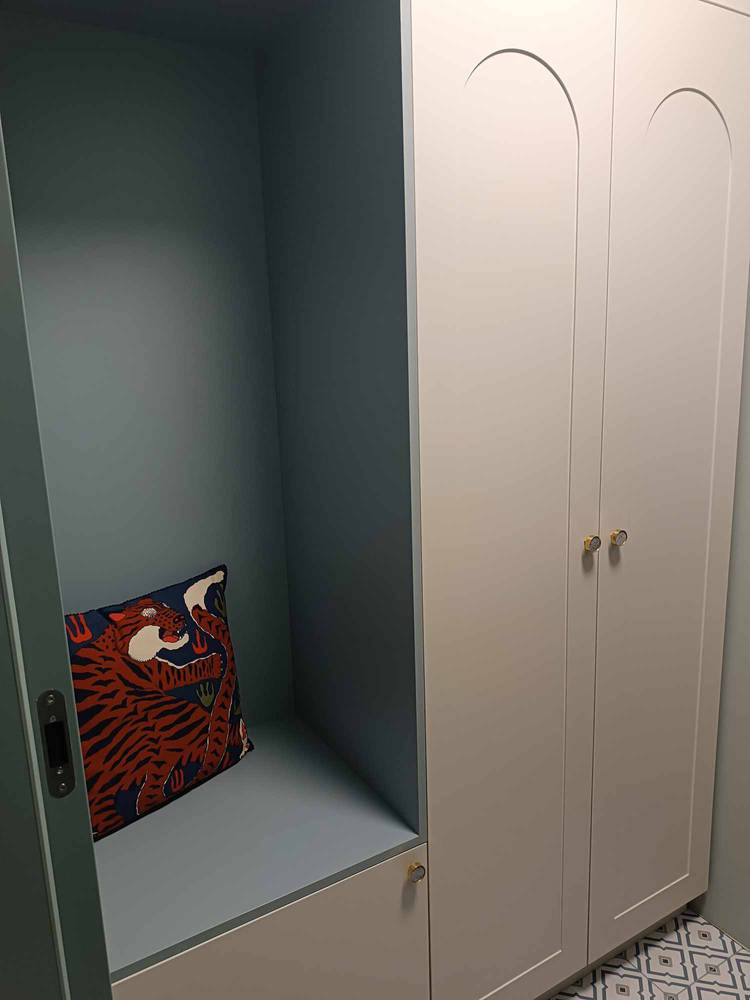<br>`https://cdn.fixly.pl/feedback/2268275-3fe484590292299b1a0c1bc54c886193.jpg` |
| 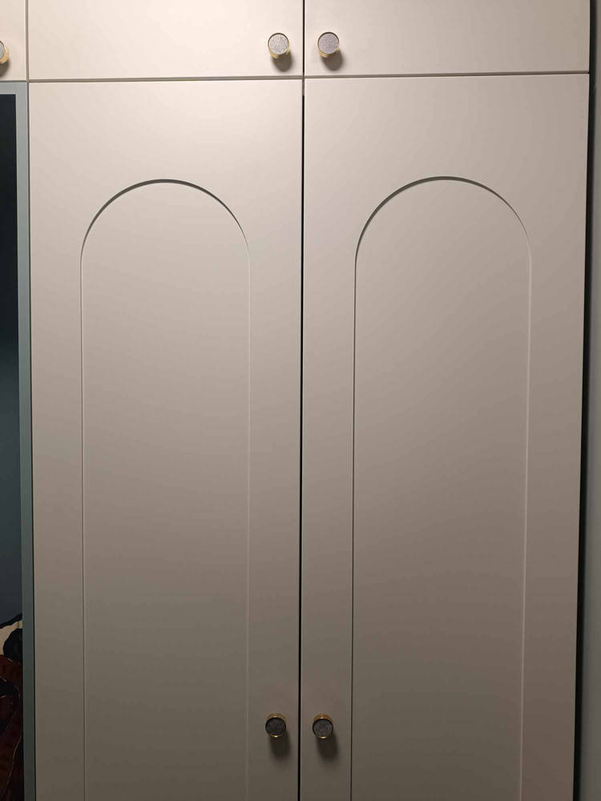<br>`https://cdn.fixly.pl/feedback/2268275-e8213077a29c364af0d687c652058b5a.jpg` | 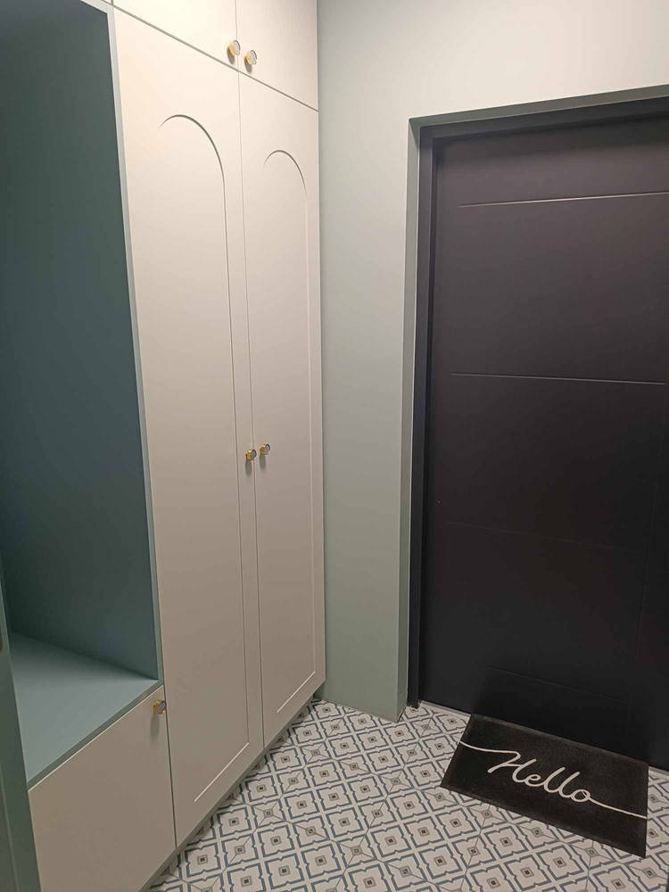<br>`https://cdn.fixly.pl/feedback/2268275-77dd48033f201b0ff0d9449cea13c2de.jpg` |

---

## Opinia ID: `1182277` (2024-10-11 11:12:31 UTC) — Jarek, Legnica (ocena: 5/5)

> Bardzo profesjonalne podejscie do klienta. Szafa taka jak chcialem przy nierównych scianach i wszystko dokladnie pod wymiar . Polecam na 100%

*Brak odpowiedzi spółki.*

|  |
|--|
| 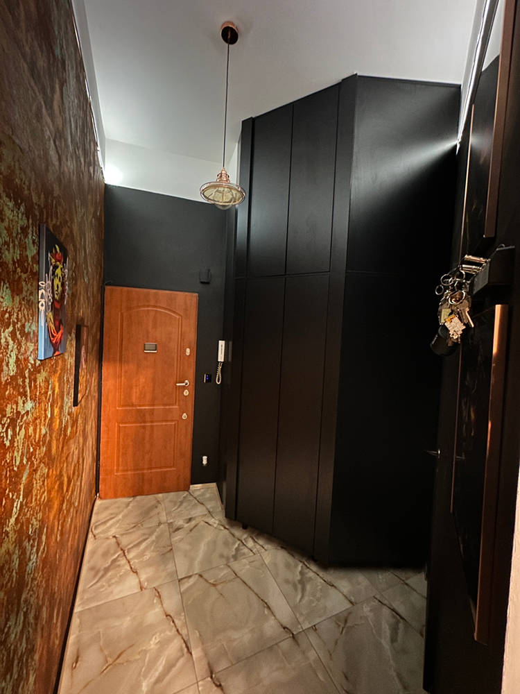<br>`https://cdn.fixly.pl/feedback/3237528-4e5254b1d338dd207d2e6e63f24da194.jpg` |

---

## Opinia ID: `1172666` (2024-09-24 20:16:16 UTC) — Sabina, Krynica-Zdrój (ocena: 1/5)

> Nie polecam! Zdjecia pokazują jakość wykonanych mebli, a wykonawca twierdzi, że umowa zostala wykonana prawidlowo jak na profesjonaliste przystało!

**Odpowiedź spółki** (ID: `47680`, 2024-09-24 20:31:07 UTC):
> Zdjęcie numer jeden, element który klient zgubił na budowie przez ogromny bałagan - poinformowałem o możliwości otrzymania nowego.
> Zdjęcie numer dwa - przed zamówieniem informowałem, że takie historie mogą mieć miejsce z uwagi na fakt że budynek przez wykonawce został bardzo źle postawiony, ściany każda ucieka z kąta, natomiast odchyły od pionu na ścianach wynoszą nawet 3cm.
> Zdjęcie numer trzy cztery oraz pięć to ja nie wiem co się działo po moim odjeżdzie, usterek nie było a wyciecie w blacie nie stanowiło przedmiotu umowy, kto co tam rzeźbił później to ja nie wiem. Nie polecam współpracy.

|  |  |
|--|--|
| 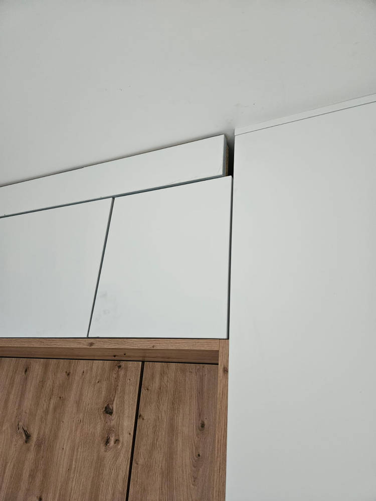<br>`https://cdn.fixly.pl/feedback/2790458-382c27ca75ecb7ccafc1700aae9f3762.jpg` | 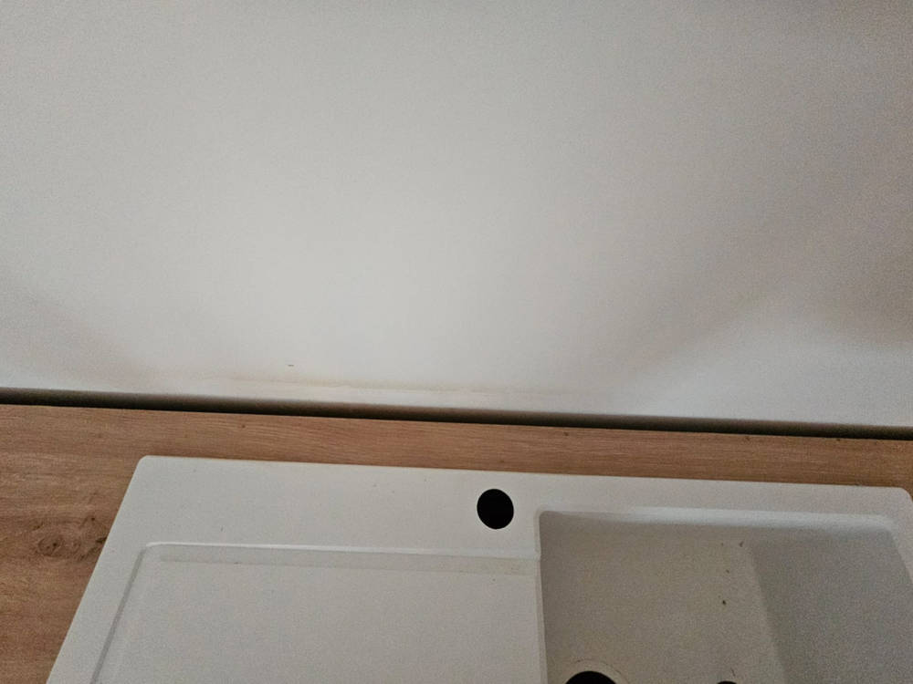<br>`https://cdn.fixly.pl/feedback/2790458-07d7d31bf07e144440a32e3281607c77.jpg` |
| 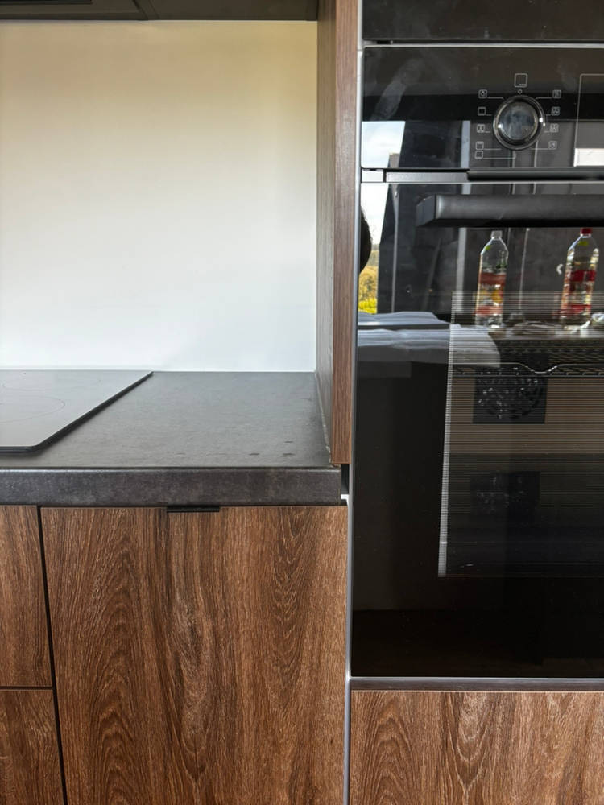<br>`https://cdn.fixly.pl/feedback/2790458-11c4cc6e013666c76cd196a9ecd0f8e8.jpg` | 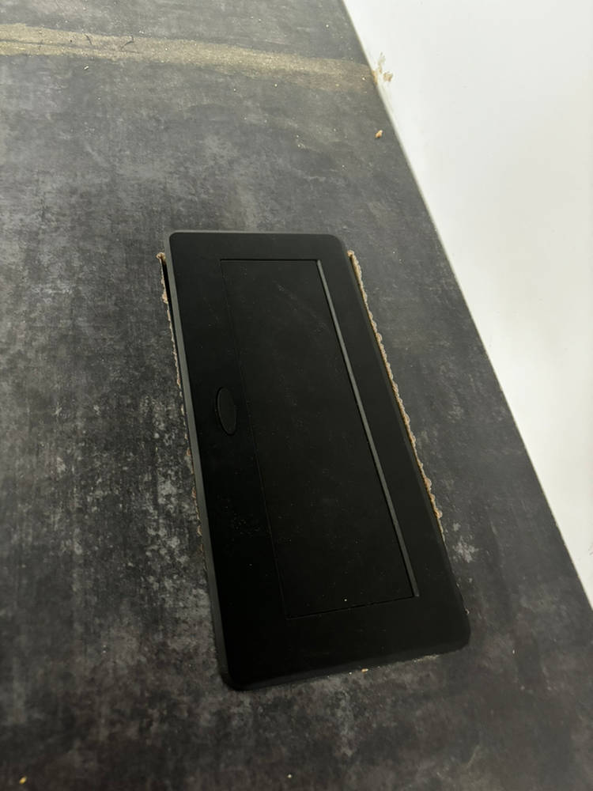<br>`https://cdn.fixly.pl/feedback/2790458-e260e481c4be474495130768938e4744.jpg` |
| 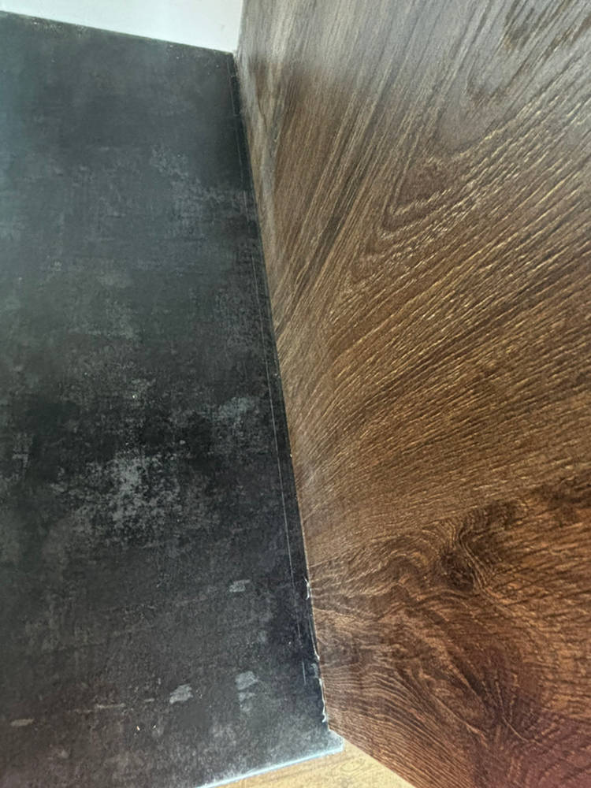<br>`https://cdn.fixly.pl/feedback/2790458-1a48ef11106ca6d03387e966f47bc5f6.jpg` |  |
